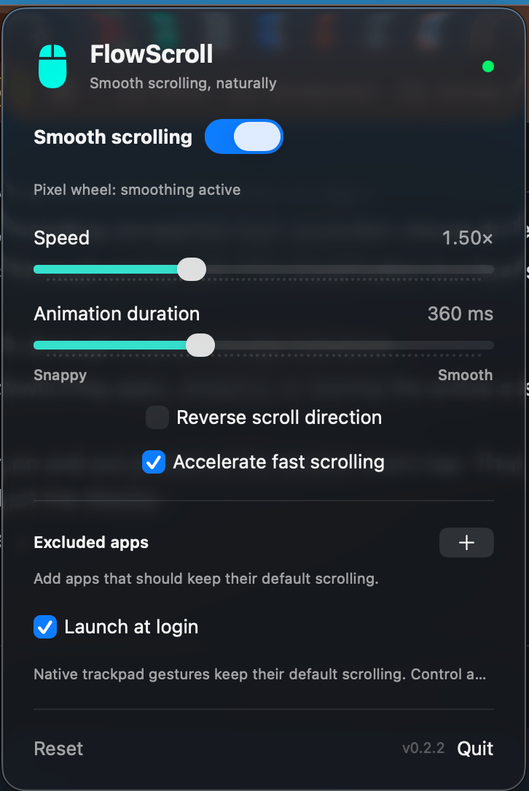

# FlowScroll

A lightweight macOS menu bar app that smooths mouse wheel scrolling. Built with Swift and SwiftUI, with no third-party dependencies or network requests. Requires macOS 13 or later.



## Download and install

**[Download FlowScroll 0.2.2 for macOS](https://github.com/pashkes/FlowScroll/raw/refs/heads/master/downloads/FlowScroll-0.2.2-universal.zip)** — ready to run; no Xcode or compilation required.

1. Download and unzip the archive.
2. Move **FlowScroll.app** to **Applications** before opening it or granting permissions.
3. Open the app and click the mouse icon in the menu bar.
4. Enable FlowScroll in **System Settings → Privacy & Security → Accessibility**. Restart the app if necessary.

The repository is private, so you must be signed in to a GitHub account with access to download the file. The [SHA-256 checksum](downloads/FlowScroll-0.2.2-universal.zip.sha256) is included for integrity verification.

### Compatibility

| Requirement | Support |
| --- | --- |
| Operating system | macOS 13 Ventura or later |
| Apple Silicon (M1 and later) | Native arm64 executable included |
| Intel Mac | Native x86_64 executable included; not yet tested on physical Intel hardware |
| Windows / Linux / macOS 12 and earlier | Not supported |

The ZIP contains a universal macOS app with both architectures; Rosetta is not required. Device testing has been performed on an Apple Silicon Mac; older supported macOS versions and other hardware still need validation.

**First-launch security prompt:** this build is ad-hoc signed and is not notarized by Apple. macOS may block an Internet-downloaded copy. If you trust this repository and intend to run the app, follow [Apple's instructions for opening an unnotarized app](https://support.apple.com/en-us/102445): attempt to open it, then use **System Settings → Privacy & Security → Open Anyway** if that option is available. This does not require disabling Gatekeeper system-wide.

Accessibility access is required for smoothing. After replacing or rebuilding the app, you may need to remove its old Accessibility entry and add the new copy again. Mouse drivers and other smoothing utilities can affect compatibility; enable only one scrolling smoother at a time.

## Features

- Display-synchronized scrolling using NSScreen/CADisplayLink on macOS 14+ and Core Video on macOS 13.
- Independent wheel impulses with a smooth acceleration and deceleration curve.
- Adjustable speed (0.25–4×) and animation duration (120–800 ms).
- A 60-point base wheel step and optional acceleration for fast wheel rotation.
- Reverse scrolling, per-app exclusions, saved preferences, and launch at login.
- Support for phase-free pixel wheel events, including compatible high-resolution mouse drivers.
- Native scroll and momentum gestures pass through unchanged. This classification is a heuristic, not hardware identification.
- Control and Command wheel shortcuts pass through to preserve app shortcuts.
- Direction changes cancel the previous tail; switching apps, sleeping, or leaving the active session cancels motion.
- Output frames use the current cursor position and are posted at the session event tap. The wheel's original position is used only to select the display.
- English interface and input status messages.

## Build and run

Install Apple's Command Line Tools if needed:

```sh
xcode-select --install
```

Build and launch:

```sh
bash scripts/build.sh
open build/FlowScroll.app
```

To build the universal downloadable ZIP and checksum:

```sh
bash scripts/package.sh
```

For regular use, move the app to `~/Applications` or `/Applications` **before granting permissions**. Click the mouse icon in the menu bar, open System Settings, and enable FlowScroll under **Privacy & Security → Accessibility**. Restart the app if necessary. Run only one copy at a time.

The build uses an ad-hoc signature, without an Apple Developer ID or notarization. Rebuilding changes the signature and can invalidate Accessibility access. If the switch is on but the app still reports no access, remove the old Accessibility entry, add the current app again, enable it, and restart the app.

## Settings

**Reset** applies a starting profile of 1× speed, 360 ms duration, and fast-wheel acceleration enabled. A slow discrete wheel event moves 60 points; rapid rotation increases the step up to 7×. Pixel wheel input retains its point distance and does not receive additional wheel acceleration.

Only one smoothing utility should process scrolling at a time. FlowScroll warns when SmoothScroll is also running. Its motion curve is an independent implementation; identical behavior to SmoothScroll is not guaranteed.

## Tests

```sh
bash scripts/test.sh
bash scripts/check-display.sh
```

The 16 automated checks run with Command Line Tools, without XCTest or a full Xcode installation. They cover distance preservation, refresh-rate independence, finite duration, gentle attack, overlapping impulses, input timing, dropped frames, acceleration, reversal, input classification, and outgoing event coordinates.

The display check requires a graphical user session with access to WindowServer. It cannot run inside a sandbox without that access.

Manual checks: a long browser page, Finder, horizontal scrolling, an excluded app, trackpad gestures, Control/Command wheel shortcuts, enabling and disabling smoothing, and moving the cursor during an inertia tail. macOS 13 and high-refresh-rate or multi-display setups still need device testing.

## Diagnostics and limitations

The menu shows how the most recent input was classified. Aggregate event and frame counters are written every two seconds to `NSTemporaryDirectory()/flowscroll-status-<uid>.json`. These diagnostics do not include window contents, pointer coordinates, or application names.

Mouse drivers that emit native gesture phases bypass smoothing. Individual speed profiles per app are not implemented. Launch at login and scrolling behavior should be checked on the target Mac with the actual mouse.

Scrolling uses the public [Core Graphics CGEvent API](https://developer.apple.com/documentation/coregraphics/cgevent). Development notes and regression records are in `docs/features/smooth-scroll/_fixes/`.
